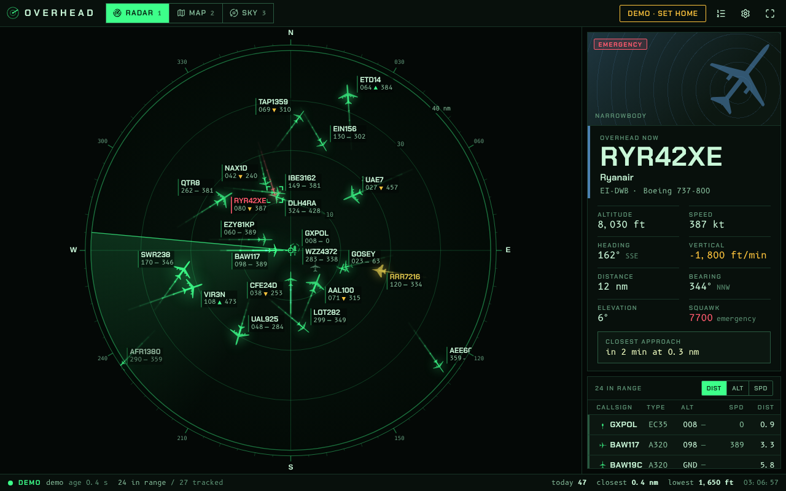
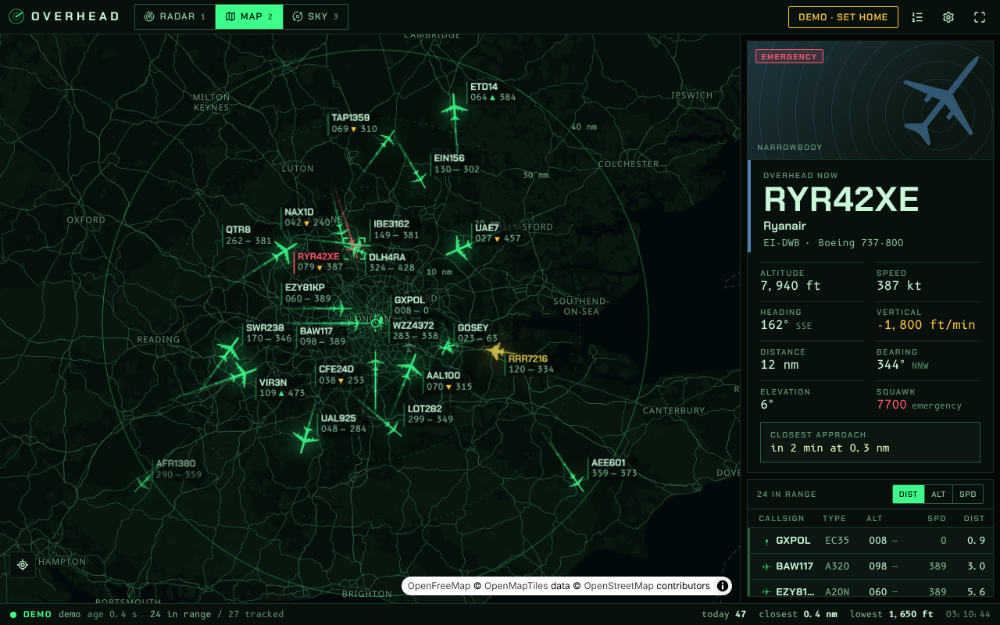
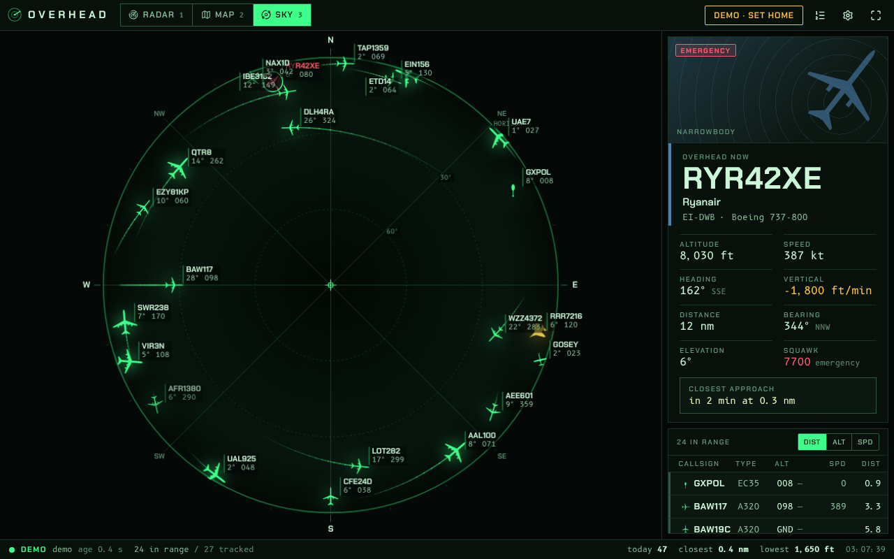

# Overhead

A desktop app that shows the aircraft above you, live. It polls public ADS-B feeds, works out what is near you and what is about to pass overhead, and draws it as a radar, a sky dome or a map. Built with Tauri 2 (Rust core, Svelte + TypeScript front end).



| Map | Sky |
|---|---|
|  |  |

Three themes ship: **Phosphor** (default), **Amber** and **Daylight**. See `docs/screenshots/` for all of them.

## Download

Installers for Windows (`.exe`, `.msi`), macOS (`.dmg`, Apple Silicon and Intel) and Linux (`.AppImage`, `.deb`, `.rpm`) are attached to each [GitHub Release](../../releases). The builds are not code-signed, so Windows SmartScreen and macOS Gatekeeper will warn on first launch.

## Using it

On first launch the app runs in **demo mode** with synthetic traffic around London so you can look around. Open Settings and set your home location (click the map or type coordinates) to switch to live data.

| Key | Action |
|---|---|
| `1` `2` `3` | Radar, Map, Sky |
| `j` `k` / arrows | Cycle through aircraft |
| `f` | Kiosk mode (Esc leaves) |
| `Esc` | Unpin, close panels |

Click an aircraft to pin it. A pin overrides the automatic "overhead now" pick until the plane leaves range. Alerts cover flyovers, military aircraft, emergency squawks (7500/7600/7700) and a personal watch list, with per-rule cooldowns and quiet hours. Sightings are stored locally in SQLite for 90 days and can be exported as CSV.

## Data sources and terms

Overhead reads community ADS-B aggregators over HTTP, in this order, failing over automatically on errors, rate limits or malformed responses:

1. [airplanes.live](https://airplanes.live)
2. [adsb.fi](https://adsb.fi)
3. [adsb.lol](https://adsb.lol)

Requests are limited to about one per second in total, sent with `User-Agent: Overhead/0.1`. These feeds are for **personal, non-commercial use**; read each provider's terms before using the app. Overhead does not try to see through aircraft that are filtered or flagged private, and it never invents live data: when no provider answers, the status bar says so.

Aircraft photos come from [Planespotters.net](https://www.planespotters.net) when available, cached on disk. Basemap tiles come from [OpenFreeMap](https://openfreemap.org); map data © [OpenStreetMap](https://www.openstreetmap.org/copyright) contributors, schema © [OpenMapTiles](https://openmaptiles.org). Fonts are B612 Mono and Chakra Petch (SIL OFL, via Fontsource). The aircraft silhouettes are drawn for this project.

## Development

Requirements: Node 22+, a recent stable Rust toolchain, and on Linux the Tauri system libraries (`libwebkit2gtk-4.1-dev`, `libappindicator3-dev`, `librsvg2-dev`, `patchelf`, `libssl-dev`, `libxdo-dev`).

```sh
npm ci
npm run tauri dev        # desktop app with hot reload
npm run dev              # front end only, in a browser, with a built-in mock engine
npm run check && npm test
cargo test --workspace
cargo clippy --workspace --all-targets -- -D warnings
```

The browser mode takes URL parameters: `?view=radar|map|sky&theme=amber|daylight&home=1&panel=1&alerts=1&fresh=1&t=<seconds>`. `npm run screenshots` regenerates `docs/screenshots/` (needs Chrome).

### Replay

Play recorded data instead of polling:

```sh
npm run tauri dev -- -- --replay tests/fixtures/demo_replay.json
```

A replay file is either `{"frames":[{"t":0,"body":{...}}],"home":{"lat":..,"lon":..}}` or a single raw provider response, which is advanced by dead reckoning. `tests/fixtures/` holds a few live captures (`live_*`) and generated ones (`synthetic_*`); `cargo run -p overhead-core --example gen_fixtures` rebuilds the synthetic set.

### Layout

- `crates/core`: networking, merging, geometry, scoring, alerts, SQLite, replay. Pure Rust, tested without a webview.
- `src-tauri`: thin shell (commands, tray, notifications, window modes).
- `src`: Svelte UI. It only draws what the core sends.

## Releasing

Push a tag such as `v0.1.0`. The **Release** workflow builds installers on Windows, Linux and macOS and attaches them to a GitHub Release. Running it manually from the Actions tab builds the same installers and keeps them as workflow artifacts. See [DECISIONS.md](DECISIONS.md) for design notes.

## License

MIT. The data providers have their own terms.
